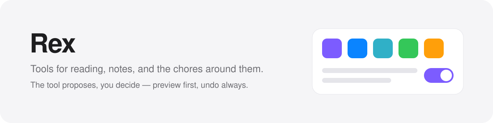

<picture>
  <source media="(prefers-color-scheme: dark)" srcset="assets/banner-dark.svg">
  
</picture>

I'm Rex. I studied clinical medicine and build the tools I use every day to read, write and keep track of things.

**The tool proposes, you decide:** every change is previewed first and can be undone.

## Obsidian plugins

| Plugin | What it does | Get it |
|---|---|---|
| **Git Note History** | Browse a note's Git history, compare any two versions and restore one paragraph or the whole note. | [Directory](https://community.obsidian.md/plugins/git-note-history) · [GitHub](https://github.com/Rexxall/obsidian-git-history-view) |
| **AI Assistant Suite** | An AI suggests a title, tags, a folder and tidier text for a note; you apply only what you accept. | [Directory](https://community.obsidian.md/plugins/ai-assistant-suite) · [GitHub](https://github.com/Rexxall/obsidian-ai-assistant-suite) |
| **Polyglot Helper** | Look up English and Japanese words in your notes and get a study card with meaning, reading, examples and audio. | [Directory](https://community.obsidian.md/plugins/polyglot-helper) · [GitHub](https://github.com/Rexxall/obsidian-polyglot-helper) |
| **Video Summary** | Turn video links, recordings and transcripts into notes with a summary, a timestamped transcript and key points. | [Directory](https://community.obsidian.md/plugins/video-summary) · [GitHub](https://github.com/Rexxall/obsidian-video-summary) |
| **Pass Countdown** | Count down a multi-use pass: uses left, time left, and the latest moment to start the next one. | [Directory](https://community.obsidian.md/plugins/pass-countdown) · [GitHub](https://github.com/Rexxall/obsidian-pass-countdown) |
| **Japan Work Secretary** | Part-time shifts in Japan: pay by time band, a warning before the 28-hour student limit, calendar sync. | [GitHub](https://github.com/Rexxall/japan-work-secretary) |
| **AI Accounting** | A multi-currency ledger in Markdown. The AI drafts entries from receipts; you check them before saving. | [GitHub](https://github.com/Rexxall/obsidian-ai-accounting) |

AI features use your own key, with DeepSeek, Qwen, SiliconFlow, Kimi and Zhipu built in.

## Web apps

| App | What it does |
|---|---|
| [Noesis Paper Reader](https://github.com/Rexxall/noesis-paper-companion) · [open](https://rexxall.github.io/noesis-paper-companion/) | Read a paper in three passes and come out able to explain it. |
| [Bunmyaku](https://github.com/Rexxall/bunmyaku-nihongo) | Turn any Japanese material into a local study desk. |
| [Evidence Inbox](https://github.com/Rexxall/obsidian-evidence-inbox) | Save a public post into Obsidian with its text, images and source link. |

## How I build

- Start from a real chore.
- Keep data local, in Markdown and Git.
- Follow the host app's theme.

Languages: Chinese, Uyghur, English, Japanese.
