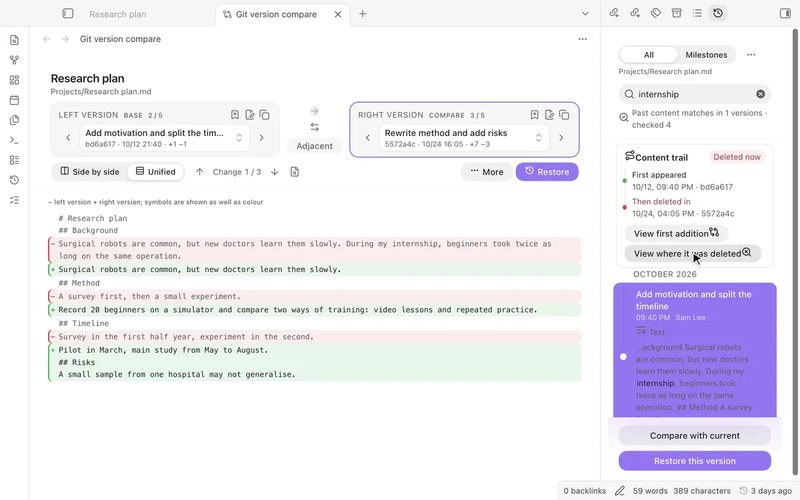
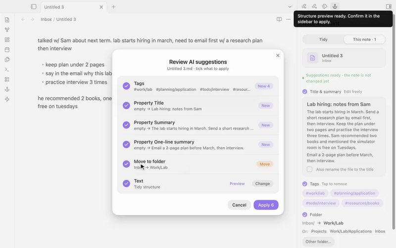
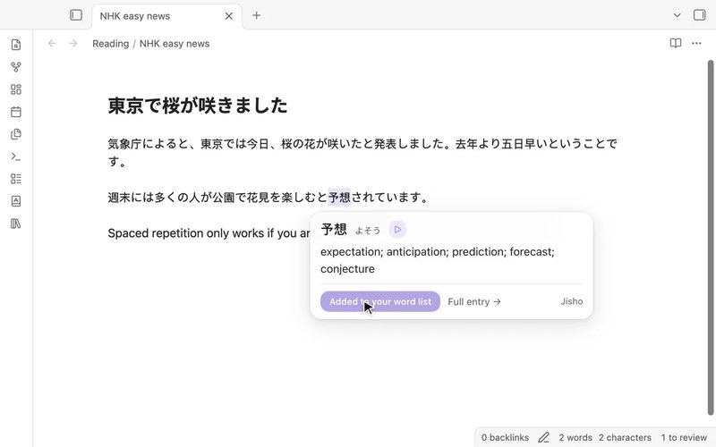
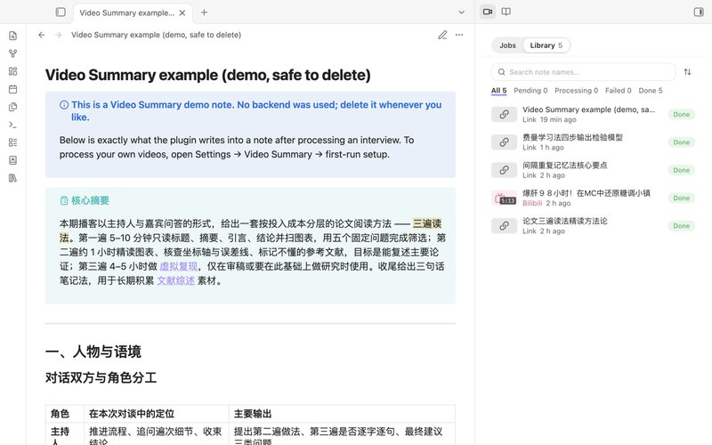
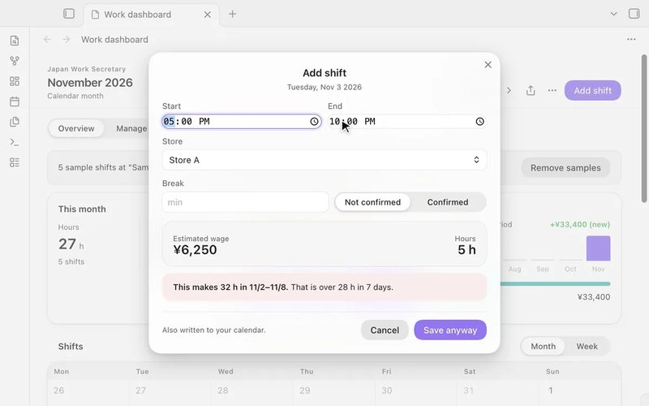
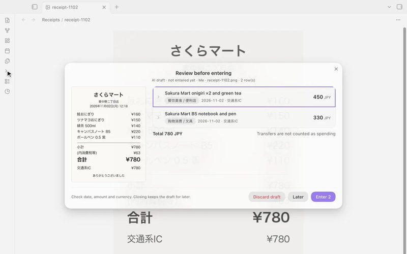
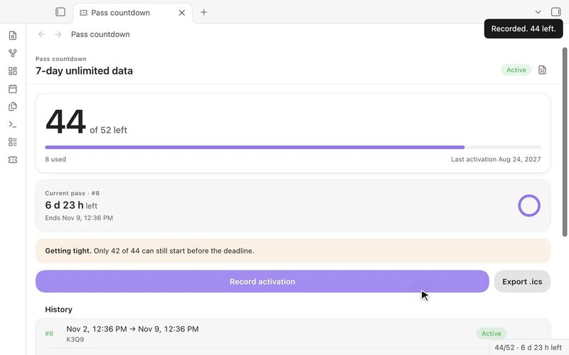

<picture>
  <source media="(prefers-color-scheme: dark)" srcset="assets/banner-dark.svg">
  
</picture>

I'm Rex. I studied clinical medicine and build the tools I use every day to read, write and keep track of things.

**The tool proposes, you decide:** every change is previewed first and can be undone.

## Obsidian plugins

<table>
<tr>
<td width="50%" valign="top">

 <b>Git Note History</b> Find a sentence you deleted, compare any two versions, restore one paragraph. 
<a href="https://community.obsidian.md/plugins/git-note-history">Directory</a> · <a href="https://github.com/Rexxall/obsidian-git-history-view">GitHub</a>
</td>
<td width="50%" valign="top">

 <b>AI Assistant Suite</b> An AI suggests title, tags, folder and tidier text; you tick what to apply. 
<a href="https://community.obsidian.md/plugins/ai-assistant-suite">Directory</a> · <a href="https://github.com/Rexxall/obsidian-ai-assistant-suite">GitHub</a>
</td>
</tr>
<tr>
<td width="50%" valign="top">

 <b>Polyglot Helper</b> Look up Japanese and English words in a note and keep them for review. 
<a href="https://community.obsidian.md/plugins/polyglot-helper">Directory</a> · <a href="https://github.com/Rexxall/obsidian-polyglot-helper">GitHub</a>
</td>
<td width="50%" valign="top">

 <b>Video Summary</b> Video links and recordings into notes with a clickable, timestamped transcript. 
<a href="https://community.obsidian.md/plugins/video-summary">Directory</a> · <a href="https://github.com/Rexxall/obsidian-video-summary">GitHub</a>
</td>
</tr>
<tr>
<td width="50%" valign="top">

 <b>Japan Work Secretary</b> Part-time shifts in Japan, pay by time band, a warning before 28 hours. 
<a href="https://community.obsidian.md/plugins/japan-work-secretary">Directory</a> · <a href="https://github.com/Rexxall/japan-work-secretary">GitHub</a>
</td>
<td width="50%" valign="top">

 <b>AI Accounting</b> Receipts into a multi-currency Markdown ledger, checked before saving. 
<a href="https://community.obsidian.md/plugins/ai-accounting">Directory</a> · <a href="https://github.com/Rexxall/obsidian-ai-accounting">GitHub</a>
</td>
</tr>
<tr>
<td width="50%" valign="top">

 <b>Pass Countdown</b> Uses left, time left and the pace for a multi-use pass. 
<a href="https://community.obsidian.md/plugins/pass-countdown">Directory</a> · <a href="https://github.com/Rexxall/obsidian-pass-countdown">GitHub</a>
</td>
<td></td>
</tr>
</table>

AI features use your own key, with DeepSeek, Qwen, SiliconFlow, Kimi and Zhipu built in.

## Web apps

| App | What it does |
|---|---|
| [Noesis Paper Reader](https://github.com/Rexxall/noesis-paper-companion) · [open](https://rexxall.github.io/noesis-paper-companion/) | Read a paper in three passes and come out able to explain it. |
| [Bunmyaku](https://github.com/Rexxall/bunmyaku-nihongo) | Turn any Japanese material into a local study desk. |
| [Evidence Inbox](https://github.com/Rexxall/obsidian-evidence-inbox) | Save a public post into Obsidian with its text, images and source link. |

## How I build

- Start from a real chore.
- Keep data local, in Markdown and Git.
- Follow the host app's theme.

Languages: Chinese, Uyghur, English, Japanese.
