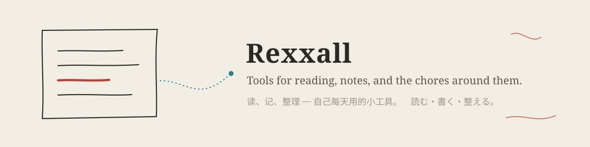

Hi, I'm Abduhelil (Rex). I studied clinical medicine, and I build the tools I use every day to read, write and keep track of things — mostly Obsidian plugins and one web app for reading papers. Each one started with something I did not want to do by hand again.

A rule that runs through all of them: **the tool proposes, the person decides.** Nothing is written back to a note without a preview and a chance to undo.

学过临床医学，现在做自己每天用的工具：读论文、整理笔记、记账、排班。每个工具都从一件“不想再手动做一遍”的事开始；共同的规矩是先预览、后写入、随时能撤销。

臨床医学を学び、今は自分が毎日使う道具を作っています。論文を読む、ノートを整える、家計簿、シフト管理。どれも「もう手作業ではやりたくない」ことから始まりました。共通のルールは、書き込む前に必ずプレビューし、いつでも取り消せること。

## Projects

| | What it does |
|---|---|
| [Noesis Paper Reader](https://github.com/Rexxall/noesis-paper-companion) · [live](https://rexxall.github.io/noesis-paper-companion/) | Read a paper in three passes — skeleton, close reading, recap — and come out able to explain it. Margin notes, citation cards, paragraph-aligned translation, a recap check that gives hints before answers. |
| [Git Note History](https://github.com/Rexxall/obsidian-git-history-view) | See how a note changed, and take back only the part you need. Selective restore, merge blocks from several versions, write-time checks, undo. Read-only Git. |
| [AI Assistant Suite](https://github.com/Rexxall/obsidian-ai-assistant-suite) | AI proposes tags, properties, structure and a folder for a note; you review the whole note and apply only what you accept. |
| [Polyglot Helper](https://github.com/Rexxall/obsidian-polyglot-helper) | Look a word up in several dictionaries at once, keep it as a study note, review it on a schedule. English and Japanese. |
| [Bunmyaku](https://github.com/Rexxall/bunmyaku-nihongo) | Turn any Japanese material into a local study desk: furigana reading, vocabulary, listening loops, exercises, and a tutor that only sees the current lesson. Content comes from course packs an agent can build. |
| [Video Summary](https://github.com/Rexxall/obsidian-video-summary) | Turn videos into searchable notes with timestamped sources, with a browser extension and your own n8n workflow. |
| [Japan Work Secretary](https://github.com/Rexxall/japan-work-secretary) | Shifts, wages and the 28-hour rule for part-time work in Japan, with incremental calendar sync. |
| [AI Accounting](https://github.com/Rexxall/obsidian-ai-accounting) | A multi-currency ledger in Markdown. Review what the AI read from a receipt before it is saved. |
| [Pass Countdown](https://github.com/Rexxall/obsidian-pass-countdown) | Count down multi-use passes: uses left, time left, pace, calendar reminders. |
| [Evidence Inbox](https://github.com/Rexxall/obsidian-evidence-inbox) | Save public posts into Obsidian as source-backed notes. No login, no background sync. *(alpha)* |

## How I work

- Start from the real chore, not from the feature list.
- Keep data local and in plain files (Markdown, Git) so it outlives the tool.
- Make writes safe: preview first, check the file again at write time, keep an undo.
- Prefer one clear entry point over many.

## Languages

Chinese, Uyghur, English, Japanese.
